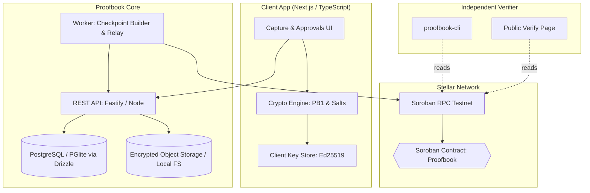

# Proofbook: 10-Day Incremental Implementation Plan

This document outlines the 10-day roadmap to build, test, deploy, and verify **Proofbook**—a privacy-preserving, tamper-evident evidence trail anchored on Stellar / Soroban.

---

## Architecture Overview



---

## 10-Day Progress Dashboard

- [x] **Day 1: Monorepo Setup & Soroban Smart Contract** *(Completed)*
- [x] **Day 2: Testnet Deployment & Automation Scripts** *(Completed)*
- [x] **Day 3: Cryptographic Engine (`packages/crypto`) — Format PB1** *(Completed)*
- [x] **Day 4: Stateless Verifier & CLI (`packages/verifier`, `cli/proofbook-cli`)** *(Completed)*
- [x] **Day 5: Database Schema & Records API (`apps/api`)** *(Completed)*
- [x] **Day 6: Maker-Checker Approvals & Evidence Storage** *(Completed)*
- [x] **Day 7: Checkpoint Worker & Auto-Anchoring (`apps/worker`)** *(Completed)*
- [x] **Day 8: Auditor Workspace & Proof Bundler** *(Completed)*
- [x] **Day 9: Web Application (`apps/web`)** *(Completed)*
- [ ] **Day 10: Auditor UI, End-to-End Testing & Demo Drill**

---

## Daily Milestones & Deliverables

### Day 1: Monorepo Setup & Soroban Smart Contract ✅
- [x] Root workspaces: `pnpm-workspace.yaml`, `package.json`, root `Cargo.toml`.
- [x] Pinned `Cargo.lock` with Soroban SDK 22 and compatible `ed25519-dalek` 2.2.0.
- [x] Implemented Soroban contract in `contracts/proofbook/src/lib.rs`:
  - `register_org`, `anchor_checkpoint`, `witness_checkpoint`, `authorize_auditor`, `revoke_auditor`, `latest_checkpoint`, `is_witnessed_by`, `get_checkpoint`.
  - Persistent storage TTL extension helpers.
- [x] Comprehensive adversarial unit tests in `contracts/proofbook/src/test.rs` (5/5 tests passing).
- [x] WASM target build (`target/wasm32-unknown-unknown/release/proofbook.wasm` — 17.8 KB).

---

### Day 2: Testnet Deployment & Automation Scripts ✅
- [x] Install and configure Stellar TypeScript SDK (`@stellar/stellar-sdk`).
- [x] Create `contracts/proofbook/scripts/deploy-testnet.ts`:
  - Testnet account generation and Friendbot auto-funding with IPv4 fallback & retry strategy.
  - Contract WASM upload and instantiation via Soroban RPC.
  - Automatic update of `PROOFBOOK_CONTRACT_ID` and `FEE_PAYER_SECRET` in `.env`.
- [x] Create `contracts/proofbook/scripts/interact-testnet.ts`:
  - Live invocation of `register_org` and `anchor_checkpoint` with authorization.
  - On-chain simulation and verification of `latest_checkpoint` state and continuity.
- [x] Automated CI / npm scripts: `pnpm contract:deploy`, `pnpm contract:interact`, and `pnpm contract:test`.

**Verification:**
```bash
pnpm --filter @proofbook/contracts deploy:testnet
pnpm --filter @proofbook/contracts interact:testnet
```

---

### Day 3: Cryptographic Engine (`packages/crypto`) — Format PB1 ✅
- [x] Initialize `packages/crypto` with TypeScript + Node.js/WebCrypto + `@noble/hashes` + `@noble/ed25519`.
- [x] Implement PB1 canonical serialization (RFC 8785 subset, fixed precision, deterministic ordering).
- [x] Implement salted field commitments:
  $$\text{commit}(k, v, s) = \text{SHA256}(0x02 \parallel \text{len\_u16\_be}(k) \parallel k \parallel \text{len\_u32\_be}(v) \parallel v \parallel s)$$
- [x] Implement PB1 Merkle Tree builder:
  - Record leaf domain separation (`0x00`).
  - Internal node domain separation (`0x01`).
  - Odd-node promotion without duplicate hashing.
  - Merkle proof generator with side indicators (`left` / `right`).
- [x] Test vectors suite matching `/spec/FORMAT.md` and automated validation script.

**Verification:**
```bash
pnpm --filter @proofbook/crypto test
pnpm test:vectors
```

---

### Day 4: Stateless Verifier & CLI (`packages/verifier`, `cli/proofbook-cli`) ✅
- [x] Initialize `packages/verifier`:
  - Standalone, zero-server dependency bundle verification.
  - Recompute field commitments, selective disclosure Merkle paths, and leaf hash.
  - Verify Merkle proof against expected root.
  - Check Ed25519 author and checker signatures.
  - Stellar RPC reader: verify on-chain checkpoint, ledger sequence, timestamp, and auditor witness records.
- [x] Build `cli/proofbook-cli`:
  - Executable CLI: `proofbook verify <path-to-bundle.json> --network testnet`.
  - Supports `--skip-blockchain` / `--offline` mode and `--json` machine-readable output.
  - Colorized terminal report for audit compliance.
- [x] Live Testnet Verification:
  - Anchored test vector checkpoint on Soroban contract `CDB4DCLRAIAGILGM4DWIOKOTSWDDY6IGP4X4FF62DA3GUQQ4LEKD5VCD`.
  - Authorized auditor `GBHTYTJU...` and witnessed checkpoint #1 on-chain.

**Verification:**
```bash
pnpm --filter proofbook-cli build
./cli/proofbook-cli/bin/proofbook verify ./spec/test-vectors/sample-bundle.json --network testnet
```

```text
Proofbook PB1 Audit Verifier v0.1.0
Bundle:     /path/to/spec/test-vectors/sample-bundle.json
Record ID:  01HZX6789ABCDEF0123456789A (Network: testnet)
──────────────────────────────────────────────────────────
Recomputed leaf ............. OK [4ffebfe1...debb6e]
Merkle path to root ......... OK (2 steps)
On-chain checkpoint #1 ...... root matches (ledger 5591134)
Author signature ............ OK (ea4a6c63...)
Approver signatures ......... OK (1 of 1 required)
Auditor witnesses ........... 1 (GBHTYTJU...)
──────────────────────────────────────────────────────────
RESULT: VERIFIED ✓
```

---

### Day 5: Database Schema & Records API (`apps/api`) ✅
- [x] Setup Fastify/Node REST API in `apps/api`.
- [x] Configure Drizzle ORM supporting both PostgreSQL (via `DATABASE_URL`) and in-process PGlite (`@electric-sql/pglite`) for zero-Docker setups.
- [x] Database Schema:
  - `users`, `user_keys` (Ed25519 public keys and revocation tracking)
  - `orgs`, `memberships` (roles: `admin`, `maker`, `checker`, `auditor`)
  - `records` (`status: draft|pending|approved|rejected|shredded`, `leaf_hash`, `field_root`, `ciphertext_ref`, `seq_no`)
  - `record_signatures` (author and approver co-signatures)
  - `evidence`, `checkpoints`, `checkpoint_records`, `merkle_nodes`
- [x] Authentication endpoints & public key registration (`/api/v1/auth/register`, `/api/v1/auth/login`, `/api/v1/auth/me`, `/api/v1/auth/keys`).
- [x] Organization & membership management (`/api/v1/orgs`, `/api/v1/orgs/:id/members`).
- [x] Encrypted record ingestion endpoint (`POST /api/v1/orgs/:id/records`): verifies PB1 `leaf_hash` and author Ed25519 signature before persisting, assigns monotonic sequence number, and stores encrypted payload via pluggable `StorageProvider`.
- [x] Record query & retrieval endpoints (`GET /api/v1/orgs/:id/records`, `GET /api/v1/orgs/:id/records/:rid`).

**Verification:**
```bash
pnpm --filter @proofbook/api test
```

```text
▶ Fastify App Initialization (1 test)
▶ Authentication & Key Management Routes (4 tests)
▶ Database & Schema Initialization (3 tests)
▶ Organization & Membership Routes (1 test)
▶ Encrypted Record Ingestion & Retrieval Routes (3 tests)
▶ Schema & Relation Constraints (3 tests)
✔ 15 tests passed across 6 test suites
```

---

### Day 6: Maker-Checker Approvals & Evidence Storage ✅
- [x] Maker-checker workflow:
  - Submit record moves status to `pending` (`POST /api/v1/orgs/:id/records/:rid/submit` & direct submission).
  - Author cannot approve their own record (enforced by user ID and signing key ID checks).
  - Endpoint `POST /api/v1/orgs/:id/records/:rid/approve`: Checker verifies Ed25519 signature over `leaf_hash` and appends `approver` co-signature.
  - Rejection flow (`POST /api/v1/orgs/:id/records/:rid/reject`) with mandatory audit reason logged in `records` and `audit_logs`.
- [x] Evidence attachment storage:
  - Abstract storage interface (`StorageProvider`).
  - Local Encrypted File System provider (`EncryptedFileStorageProvider` using AES-256-GCM authenticated encryption at rest) for local dev.
  - S3 / MinIO provider (`S3StorageProvider` using AWS Signature Version 4) for production.
  - Calculates and binds `evidence_hash: sha256:...` into canonical record fields (`computeEvidenceHash`, `bindEvidenceField`) and serves attachments via `POST/GET /api/v1/orgs/:id/records/:rid/evidence`.

**Verification:**
```bash
pnpm --filter @proofbook/api test:workflow
```

```text
▶ Storage Providers (Memory, Local Encrypted FS, and S3/MinIO) (4 tests)
▶ Maker-Checker Approvals, Rejection Audit Trail & Evidence Storage (3 tests)
✔ 7 tests passed across 2 test suites
```

---

### Day 7: Checkpoint Worker & Auto-Anchoring (`apps/worker`) ✅
- [x] Implement `apps/worker`:
  - Job runner (cron / interval / trigger endpoint).
  - Fetches approved records since previous checkpoint.
  - Calculates cumulative `record_count`.
  - Builds Merkle tree using `packages/crypto`.
  - Persists Merkle sibling tree nodes in database for fast path extraction.
  - Calls Soroban `anchor_checkpoint` on Stellar Testnet via fee-paying platform account + org authorization.
  - Records on-chain `tx_hash`, `ledger`, and `checkpoint_id` in database.

**Verification:**
```bash
pnpm --filter @proofbook/worker test
pnpm --filter @proofbook/worker run:once
```

```text
▶ Checkpoint Builder & Merkle Persistence (3 tests)
▶ Worker HTTP Trigger Server (4 tests)
▶ MockSorobanAnchorClient Contract Semantics (2 tests)
▶ CheckpointWorker Multi-Org & Interval Runner (2 tests)
✔ 11 tests passed across 4 test suites
```

---

### Day 8: Auditor Workspace & Proof Bundler ✅
- [x] Proof bundle generator endpoint: `POST /orgs/:id/proofs` (and `/api/v1/orgs/:id/proofs`).
  - Supports selective disclosure: masks non-disclosed fields while generating and preserving valid Merkle field proofs (`field_proofs`).
  - Exports standardized `bundle.json` with pre-flight verification via `@proofbook/verifier`.
  - Supports `?download=true` query/header for immediate bundle JSON export.
- [x] Auditor engagement endpoints:
  - `POST /orgs/:id/engagements`: Auditor invite, role assignment, and access scoping (`recordTypes`, date window, status).
  - `GET /orgs/:id/engagements` and `GET /engagements/:eid`: Engagement metadata and scope inspection.
  - `GET /engagements/:eid/records`: Read-only authorized record viewer strictly enforcing engagement scope filters.
  - `POST /engagements/:eid/witness`: Prepares and relays on-chain `witness_checkpoint` transaction signed by auditor address, preventing duplicate witnessing and verifying root consistency.
  - Dedicated Soroban auditor client with mock and live testnet implementations.

**Verification:**
```bash
pnpm --filter @proofbook/api test:auditor
```

```text
▶ Auditor Workspace & Proof Bundler
  ✔ POST /orgs/:id/proofs generates valid full-disclosure PB1 proof bundle
  ✔ POST /orgs/:id/proofs supports selective disclosure with Merkle field inclusion proofs
  ✔ POST /orgs/:id/proofs supports file download via ?download=true
  ✔ POST /orgs/:id/engagements creates auditor engagement and configures scope
  ✔ GET /engagements/:eid/records enforces engagement scope filtering
  ✔ POST /engagements/:eid/witness executes on-chain checkpoint witnessing flow
✔ Auditor Workspace & Proof Bundler (6 tests passed)
```

---

### Day 9: Web Application (`apps/web`) ✅
- [x] Initialize Next.js app with Tailwind CSS (`apps/web`).
- [x] Client-side cryptographic helper (`apps/web/src/lib/crypto-client.ts`, `apps/web/src/lib/key-store.ts`):
  - Generates per-field 32-byte CSPRNG salts and computes PB1 field commitments (`0x02`) and Merkle field roots in-browser.
  - Client-side Ed25519 key generation, storage, and record leaf (`0x00`) signing/verification using WebCrypto & `@noble/ed25519`, plus AES-256-GCM payload encryption.
- [x] Organization portal (`/portal`):
  - Record entry form (`amount`, `payee`, `currency`, `memo`, and SHA-256 bound evidence upload) with live PB1 field commitment preview.
  - Maker-checker approval queue enforcing separation of duties with one-click Checker Ed25519 co-signing, audit rejection logging, and selective disclosure PB1 proof bundle export.
- [x] Public verification page (`/verify` and `/verify/:orgAddress/:checkpointId`):
  - `/verify/:orgAddress/:checkpointId`: inspects on-chain checkpoint root, chain continuity (`prev_root`), ledger metadata, and `is_witnessed_by` auditor status directly from Stellar Soroban RPC.
  - Drag-and-drop `bundle.json` verification in browser with zero server reliance (`apps/web/src/lib/browser-verifier.ts`).

**Verification:**
```bash
pnpm --filter @proofbook/web test
pnpm --filter @proofbook/web build
pnpm --filter @proofbook/web dev
```

```text
▶ Client-Side Cryptographic Engine (Format PB1) (3 tests)
▶ Organization Portal & Maker-Checker Co-Signing Workflow (2 tests)
▶ Public Browser Verifier & Stellar Soroban Checkpoint Reader (2 tests)
✔ 7 tests passed across 3 test suites
```

---

### Day 10: Auditor UI, End-to-End Testing & Demo Drill
- [ ] Auditor workspace UI:
  - View checkpoints, check chain linkage, review evidence.
  - One-click on-chain "Witness Checkpoint" integration with Stellar wallet / key.
  - Export audit report (PDF / JSON) with embedded QR code.
- [ ] Comprehensive End-to-End drill (`test/e2e`):
  1. Maker signs record $1,250 USD to Acme Supplies.
  2. Checker approves and co-signs.
  3. Worker batches records, anchors root on Stellar Testnet.
  4. Auditor independently checks root and witnesses on Stellar.
  5. Standalone CLI and Public Web page verify the exported bundle offline.
- [ ] Final documentation update, clean scripts, and demo recording guide.

---

## Tech Stack & Standards

| Layer | Technology |
|---|---|
| **Blockchain** | Stellar / Soroban (Protocol 22), Rust `soroban-sdk` |
| **Cryptography** | PB1 (SHA-256, Ed25519, XChaCha20-Poly1305, Domain-separated Merkle) |
| **Monorepo** | pnpm workspaces, Turbo / pnpm scripts, Cargo workspaces |
| **Backend API** | Fastify / Node.js 20+, TypeScript |
| **Database** | PostgreSQL / PGlite via Drizzle ORM |
| **Object Store** | Local Encrypted FS (Dev) / S3-compatible MinIO (Prod) |
| **Frontend** | Next.js 14/15, Tailwind CSS, Lucide icons |
| **Verifier CLI** | Node.js standalone binary, published as `@proofbook/cli` |

---

## Helpful Commands

```bash
# Contract Tests
cargo test --manifest-path contracts/proofbook/Cargo.toml

# Build WASM
cargo build --manifest-path contracts/proofbook/Cargo.toml --target wasm32-unknown-unknown --release

# Inspect Contract Interface
stellar contract inspect --wasm target/wasm32-unknown-unknown/release/proofbook.wasm

# Run Entire Monorepo Test Suite
pnpm test
```
