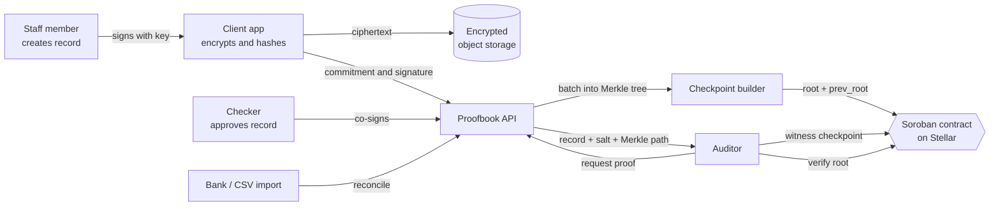
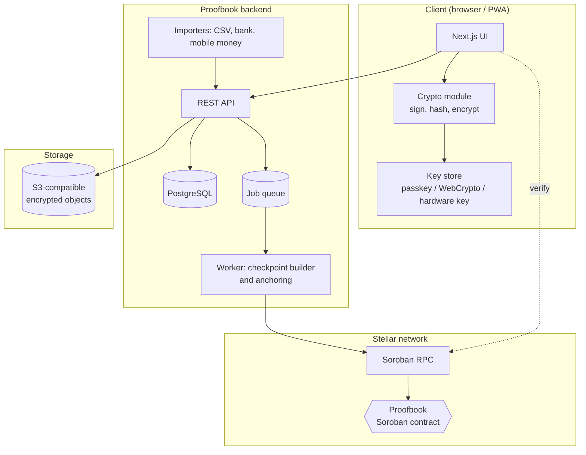

# Proofbook

**Tamper-evident, privacy-preserving evidence trails for organizations that have to prove what they did, anchored on Stellar / Soroban.**

Organizations keep their records private. Anyone with the right to check them (a donor, auditor, or regulator) can independently prove the records are authentic, complete, and unaltered, without trusting the organization and without trusting us.

[](LICENSE)
[](https://stellar.org)
[](#13-roadmap)

> **Status notice.** This README is both documentation and specification. Sections marked **(planned)** describe intended behavior that may not be implemented yet. See the [roadmap](#13-roadmap) for the current state. Do not use Proofbook for production or compliance purposes until an independent security review has been completed (see [Security](#10-security-model-and-known-limitations)).

---

## Table of contents

1. [Why Proofbook exists](#1-why-proofbook-exists)
2. [What it does](#2-what-it-does)
3. [How it works (overview)](#3-how-it-works-overview)
4. [Architecture](#4-architecture)
5. [Cryptographic specification](#5-cryptographic-specification)
6. [Soroban smart contract](#6-soroban-smart-contract)
7. [Backend API](#7-backend-api)
8. [Data model](#8-data-model)
9. [Privacy and compliance](#9-privacy-and-compliance)
10. [Security model and known limitations](#10-security-model-and-known-limitations)
11. [Repository layout](#11-repository-layout)
12. [Getting started](#12-getting-started)
13. [Roadmap](#13-roadmap)
14. [Business model](#14-business-model)
15. [FAQ](#15-faq)
16. [Contributing](#16-contributing)
17. [License](#17-license)

---

## 1. Why Proofbook exists

Trust in small organizations' records is expensive.

- A grant-funded NGO must convince donors that money was spent as promised. Today that means spreadsheets, emailed receipts, and an annual audit that costs thousands of dollars and arrives months late.
- Auditors spend most of their time collecting and cross-checking evidence, not analyzing it.
- Existing "blockchain audit" projects usually put raw data on a public chain. That is unusable for any organization with sensitive records, and it still does not prove the data was true when it was written.

Proofbook takes a narrower and more honest approach:

| Problem | Proofbook's answer |
|---|---|
| Records can be edited after the fact | Hash-linked checkpoints anchored on Stellar make later edits detectable |
| Sensitive data cannot go on a public chain | Only cryptographic commitments (Merkle roots) go on-chain; data stays encrypted off-chain |
| Auditors cannot verify without trusting the organization | Selective-disclosure proofs let an auditor verify any record against the on-chain root |
| Fake data can be entered in the first place | Signed entries, maker-checker approval, source reconciliation, and auditor witnessing raise the cost of fraud |
| Non-technical users cannot use blockchain tools | A normal web app; no wallet or crypto knowledge needed to capture, review, or verify |

### What Proofbook does **not** claim

A ledger can prove a record has not changed since it was anchored. It cannot prove the record was true when it was written. Proofbook reduces and exposes that risk (see [Section 10](#10-security-model-and-known-limitations)), but it does not eliminate it, and colluding insiders can still enter false data. We say this plainly because overclaiming is how audit technology loses credibility.

---

## 2. What it does

### For organizations (NGOs, cooperatives, small funds)

- Capture financial and operational records with author signatures.
- Require a second person to approve (maker-checker) before a record counts as approved.
- Attach evidence (receipts, photos, invoices) bound to the record by hash.
- Import bank, mobile-money, or CSV exports and automatically flag records that do not reconcile.
- Anchor a checkpoint to Stellar on a schedule (hourly or daily), automatically.
- Grant auditors and donors time-limited, scoped access to selected records.
- Delete personal data on request without breaking verifiability of the rest (crypto-shredding).

### For auditors

- Engagement workspace: request lists, evidence viewer, comments, findings.
- One-click **Verify**: recomputes the record's Merkle path and compares it with the on-chain root.
- **Witnessing**: countersign a checkpoint on-chain, so the organization cannot quietly rewrite history later.
- Export an audit report (PDF) with a QR code linking to a public verification page.

### For donors and regulators (planned)

- Read-only dashboards showing verified status across all grantees.
- Verification of any shared proof bundle with no account required.

### For anyone

- Verify a proof bundle offline against the Stellar network using the open-source CLI or the public verify page. If Proofbook the company disappears, the proofs still work.

---

## 3. How it works (overview)



**The life of a record:**

1. **Create.** A user fills in a record (for example, a payment of 1,250 USD to a supplier). The browser generates a random salt per field, builds salted field commitments, encrypts the record, and signs the result with the user's key.
2. **Approve.** A second authorized person reviews and co-signs. Unapproved records are never included in a checkpoint.
3. **Reconcile.** If a bank statement covering that date has been imported, the record is matched against it. Mismatches are flagged, not blocked, and flags travel with the record.
4. **Checkpoint.** On a schedule, approved records since the last checkpoint are placed into a Merkle tree. The root, together with the previous checkpoint's root, is anchored on Stellar by the organization's authorization.
5. **Witness.** An auditor reviews and countersigns the checkpoint on-chain.
6. **Verify.** Any time later, an authorized verifier receives the record, its salts, and a Merkle path, recomputes the root, and compares it with the value on Stellar.

---

## 4. Architecture



### Components

| Component | Responsibility | Tech |
|---|---|---|
| **Contract** | Stores checkpoint roots, chain linkage, and auditor witness records. Holds no private data. | Rust, `soroban-sdk` |
| **Client crypto module** | Key handling, salted field commitments, record encryption, signing, Merkle proof verification. All secrets stay client-side. | TypeScript, WebCrypto, `@noble/ed25519` / `@noble/hashes` |
| **Backend API** | Authentication, organization and role management, record storage, proof generation, workflow state. | TypeScript (Node), Postgres |
| **Checkpoint worker** | Builds Merkle trees, submits anchor transactions, mirrors on-chain data into Postgres. | TypeScript, `@stellar/stellar-sdk` |
| **Importers** | Parse bank and mobile-money exports, reconcile against records. | TypeScript |
| **Object storage** | Holds client-side encrypted record bodies and evidence files. | S3-compatible |
| **Verifier (library and CLI)** | Stateless verification of proof bundles against Stellar. | TypeScript, publishable as a standalone package |

### Design principles

1. **Chain stores commitments, never data.** Nothing sensitive is ever written on-chain.
2. **The platform cannot forge anchors.** The organization authorizes each anchor with its own key; the platform only pays fees and relays.
3. **Verification must not depend on us.** Proof bundles are self-contained, and the verifier is open source and runs offline apart from reading Stellar.
4. **Keys belong to users.** The server stores ciphertext and public keys, not private keys.
5. **Keep the contract tiny.** A small contract is cheaper, easier to audit, and easier to trust.

---

## 5. Cryptographic specification

> This is a **draft specification** (format version `PB1`). It must receive independent cryptographic review before production use. Treat any implementation detail here as subject to change until v1.0.

### 5.1 Primitives

| Purpose | Primitive |
|---|---|
| Hashing | SHA-256 |
| Signatures | Ed25519 (compatible with Stellar keys) |
| Record encryption | XChaCha20-Poly1305 or AES-256-GCM, with a per-record random data key |
| Key wrapping | Data key wrapped for each authorized reader with X25519 + HKDF (planned) |
| Salts | 32 random bytes from a CSPRNG, one per field |

### 5.2 Canonical record format

A record is a set of named fields. Fields are serialized in a canonical form (UTF-8, sorted keys, no insignificant whitespace; numbers as decimal strings with fixed precision; timestamps as RFC 3339 UTC) so that the same record always produces the same bytes.

```json
{
  "record_id": "01HZX6...",
  "org_id": "GBXYZ...",
  "type": "payment",
  "created_at": "2026-11-02T09:14:00Z",
  "author": "ed25519:ab12...",
  "fields": {
    "amount": "1250.00",
    "currency": "USD",
    "payee": "Acme Supplies Ltd",
    "purpose": "Classroom materials, batch 4",
    "evidence_hash": "sha256:9f86..."
  }
}
```

### 5.3 Field commitments (selective disclosure)

Each field gets its own random salt so fields can be revealed independently:

```
field_commit(name, value, salt) = SHA256( 0x02 || len_u16_be(name) || name || len_u32_be(value) || value || salt )
```

*Note on encoding:*
- `0x02` is the single-byte domain separation tag.
- `len_u16_be(name)` is the 2-byte big-endian byte-length of the UTF-8 encoded field name.
- `name` is the UTF-8 byte sequence of the field name.
- `len_u32_be(value)` is the 4-byte big-endian byte-length of the UTF-8 encoded canonical field value.
- `value` is the UTF-8 canonical byte sequence of the field value.
- `salt` is the raw 32-byte CSPRNG salt.

The record's **field root** is the Merkle root over its field commitments, sorted by field name. To prove "the amount was 1,250.00 USD" without revealing the payee, the owner discloses the `amount` and `currency` values with their salts, plus the Merkle path for the remaining commitments.

### 5.4 Record leaf

```
leaf = SHA256( 0x00 || len_u16_be(record_id) || record_id || author_pubkey_raw || len_u16_be(created_at) || created_at || field_root )
```

*Note on leaf inputs:*
- `0x00` is the single-byte domain separation tag for record leaves.
- `record_id` is length-prefixed with 2-byte big-endian integer.
- `author_pubkey_raw` is the fixed 32-byte Ed25519 public key.
- `created_at` is the RFC 3339 UTC timestamp, length-prefixed with 2-byte big-endian integer.
- `field_root` is the fixed 32-byte SHA-256 field root.

The author's signature covers `leaf`. Approval co-signatures also cover `leaf`, so approvals are bound to exactly this content.

### 5.5 Checkpoint Merkle tree

- Leaves are record leaves in a deterministic order (by approval sequence number `seq_no`).
- Internal nodes: `node = SHA256( 0x01 || left || right )`.
- The `0x00` / `0x01` / `0x02` prefixes provide domain separation between leaves, internal nodes, and field commitments, which prevents second-preimage attacks that confuse leaves with internal nodes.
- If a level has an odd number of nodes, the last node is **promoted unchanged** to the next level rather than duplicated. Duplication is a known source of ambiguity (distinct trees with the same root).
- If a checkpoint contains exactly one record, its Merkle root is `SHA256( 0x01 || leaf || [0u8; 32] )` (or the leaf itself, as explicitly pinned in `/spec/FORMAT.md`). Empty checkpoints are not anchored.

### 5.6 Checkpoint chain

Each on-chain checkpoint stores `prev_root`, the root of the preceding checkpoint (`[0u8; 32]` for the first checkpoint). The smart contract independently looks up and sets `prev_root` from the previous checkpoint in state, guaranteeing that the chain cannot branch or rewrite history without detection.

```
Checkpoint 1: root=R1, prev_root=0x00...
Checkpoint 2: root=R2, prev_root=R1
Checkpoint 3: root=R3, prev_root=R2
```

### 5.7 Proof bundle

A self-contained JSON (or ZIP with evidence) file:

```json
{
  "version": "PB1",
  "network": "testnet",
  "contract_id": "C...",
  "org": "G...",
  "checkpoint_id": 42,
  "record": { "...disclosed fields and salts...": "..." },
  "merkle_path": [{ "side": "left", "hash": "..." }],
  "signatures": { "author": "...", "approvers": ["..."] },
  "expected_root": "..."
}
```

Verification steps:

1. Recompute field commitments, field root, and leaf from the disclosed data.
2. Walk the Merkle path to a root; compare with `expected_root`.
3. Read checkpoint `42` from the contract; compare `root` and verify `prev_root` chain continuity.
4. Check author and approver signatures against the organization's registered signers.
5. Check for auditor witness records on the checkpoint.

### 5.8 Crypto-shredding

Record bodies are encrypted with per-record data keys. Deleting the encrypted body and its salts makes the on-chain commitment meaningless because the salted hash cannot be brute-forced back to its inputs. The rest of the tree stays verifiable using the stored sibling hashes.

---

## 6. Soroban smart contract

The contract is intentionally small. It stores **checkpoints** and **witness records**, and nothing else.

### 6.1 Interface

```rust
// Organizations
fn register_org(env: Env, org: Address) -> Result<(), Error>;
fn authorize_auditor(env: Env, org: Address, auditor: Address) -> Result<(), Error>;
fn revoke_auditor(env: Env, org: Address, auditor: Address) -> Result<(), Error>;

// Checkpoints
fn anchor_checkpoint(
    env: Env,
    org: Address,
    root: BytesN<32>,
    record_count: u64,
    period_start: u64,
    period_end: u64,
) -> Result<u32, Error>;                 // returns the new checkpoint id

fn witness_checkpoint(
    env: Env,
    org: Address,
    checkpoint_id: u32,
    auditor: Address,
    root_seen: BytesN<32>,
) -> Result<(), Error>;

// Reads
fn get_checkpoint(env: Env, org: Address, id: u32) -> Result<Checkpoint, Error>;
fn latest_checkpoint(env: Env, org: Address) -> Result<Checkpoint, Error>;
fn is_witnessed_by(env: Env, org: Address, id: u32, auditor: Address) -> bool;
```

`org` is a Stellar address. It can be a standard multisig account or a contract account, so organization-level approval thresholds are handled by Stellar's own authorization model rather than reimplemented in the contract.

### 6.2 Reference skeleton

> Illustrative skeleton showing the intended logic. Confirm all SDK calls and storage/TTL limits against the current Soroban documentation before building on it.

```rust
#![no_std]
use soroban_sdk::{
    contract, contracterror, contractimpl, contracttype, symbol_short, Address, BytesN, Env,
};

const TTL_THRESHOLD: u32 = 518_400;   // ~30 days at ~5s ledgers
const TTL_EXTEND_TO: u32 = 3_110_400; // ~180 days; clamp to network max

#[contracterror]
#[derive(Copy, Clone, Debug, Eq, PartialEq)]
#[repr(u32)]
pub enum Error {
    OrgAlreadyRegistered = 1,
    OrgNotRegistered = 2,
    CountDecreased = 3,
    PeriodRegression = 4,
    CheckpointNotFound = 5,
    AuditorNotAuthorized = 6,
    RootMismatch = 7,
    AlreadyWitnessed = 8,
}

#[contracttype]
#[derive(Clone)]
pub struct Checkpoint {
    pub id: u32,
    pub root: BytesN<32>,
    pub prev_root: BytesN<32>,
    pub record_count: u64, // cumulative total records anchored to date
    pub period_start: u64,
    pub period_end: u64,
    pub ledger: u32,
    pub timestamp: u64,
}

#[contracttype]
pub enum DataKey {
    Org(Address),
    Latest(Address),                 // latest checkpoint id
    Checkpoint(Address, u32),
    Auditor(Address, Address),       // (org, auditor) -> bool
    Witness(Address, u32, Address),  // (org, checkpoint, auditor) -> ledger seq
}

#[contract]
pub struct Proofbook;

#[contractimpl]
impl Proofbook {
    pub fn register_org(env: Env, org: Address) -> Result<(), Error> {
        org.require_auth();
        let key = DataKey::Org(org.clone());
        if env.storage().persistent().has(&key) {
            return Err(Error::OrgAlreadyRegistered);
        }
        env.storage().persistent().set(&key, &true);
        Self::bump(&env, &key);
        env.events().publish((symbol_short!("org_reg"), org), ());
        Ok(())
    }

    pub fn anchor_checkpoint(
        env: Env,
        org: Address,
        root: BytesN<32>,
        record_count: u64,
        period_start: u64,
        period_end: u64,
    ) -> Result<u32, Error> {
        org.require_auth();
        let org_key = DataKey::Org(org.clone());
        if !env.storage().persistent().has(&org_key) {
            return Err(Error::OrgNotRegistered);
        }
        if period_end < period_start {
            return Err(Error::PeriodRegression);
        }

        let latest_key = DataKey::Latest(org.clone());
        let (id, prev_root) = match env.storage().persistent().get::<_, u32>(&latest_key) {
            Some(last_id) => {
                let prev: Checkpoint = env
                    .storage()
                    .persistent()
                    .get(&DataKey::Checkpoint(org.clone(), last_id))
                    .ok_or(Error::CheckpointNotFound)?;
                if record_count < prev.record_count {
                    return Err(Error::CountDecreased);
                }
                if period_start < prev.period_end {
                    return Err(Error::PeriodRegression);
                }
                (last_id + 1, prev.root)
            }
            None => (1, BytesN::from_array(&env, &[0u8; 32])),
        };

        let cp = Checkpoint {
            id,
            root: root.clone(),
            prev_root,
            record_count,
            period_start,
            period_end,
            ledger: env.ledger().sequence(),
            timestamp: env.ledger().timestamp(),
        };

        let cp_key = DataKey::Checkpoint(org.clone(), id);
        env.storage().persistent().set(&cp_key, &cp);
        env.storage().persistent().set(&latest_key, &id);

        // Keep organization, checkpoint, and latest pointer persistent
        Self::bump(&env, &org_key);
        Self::bump(&env, &cp_key);
        Self::bump(&env, &latest_key);

        env.events().publish((symbol_short!("anchor"), org, id), root);
        Ok(id)
    }

    pub fn authorize_auditor(env: Env, org: Address, auditor: Address) -> Result<(), Error> {
        org.require_auth();
        let org_key = DataKey::Org(org.clone());
        if !env.storage().persistent().has(&org_key) {
            return Err(Error::OrgNotRegistered);
        }
        let key = DataKey::Auditor(org.clone(), auditor);
        env.storage().persistent().set(&key, &true);
        Self::bump(&env, &org_key);
        Self::bump(&env, &key);
        Ok(())
    }

    pub fn revoke_auditor(env: Env, org: Address, auditor: Address) -> Result<(), Error> {
        org.require_auth();
        let org_key = DataKey::Org(org.clone());
        if !env.storage().persistent().has(&org_key) {
            return Err(Error::OrgNotRegistered);
        }
        let key = DataKey::Auditor(org.clone(), auditor);
        if !env.storage().persistent().has(&key) {
            return Err(Error::AuditorNotAuthorized);
        }
        env.storage().persistent().set(&key, &false);
        Self::bump(&env, &org_key);
        Self::bump(&env, &key);
        Ok(())
    }

    pub fn witness_checkpoint(
        env: Env,
        org: Address,
        checkpoint_id: u32,
        auditor: Address,
        root_seen: BytesN<32>,
    ) -> Result<(), Error> {
        auditor.require_auth();
        let authorized: bool = env
            .storage()
            .persistent()
            .get(&DataKey::Auditor(org.clone(), auditor.clone()))
            .unwrap_or(false);
        if !authorized {
            return Err(Error::AuditorNotAuthorized);
        }
        let cp: Checkpoint = env
            .storage()
            .persistent()
            .get(&DataKey::Checkpoint(org.clone(), checkpoint_id))
            .ok_or(Error::CheckpointNotFound)?;
        if cp.root != root_seen {
            return Err(Error::RootMismatch);
        }
        let wkey = DataKey::Witness(org.clone(), checkpoint_id, auditor.clone());
        if env.storage().persistent().has(&wkey) {
            return Err(Error::AlreadyWitnessed);
        }
        env.storage().persistent().set(&wkey, &env.ledger().sequence());
        Self::bump(&env, &wkey);
        env.events().publish((symbol_short!("witness"), org, checkpoint_id), auditor);
        Ok(())
    }

    pub fn get_checkpoint(env: Env, org: Address, id: u32) -> Result<Checkpoint, Error> {
        env.storage()
            .persistent()
            .get(&DataKey::Checkpoint(org, id))
            .ok_or(Error::CheckpointNotFound)
    }

    pub fn latest_checkpoint(env: Env, org: Address) -> Result<Checkpoint, Error> {
        let latest_key = DataKey::Latest(org.clone());
        let last_id: u32 = env
            .storage()
            .persistent()
            .get(&latest_key)
            .ok_or(Error::CheckpointNotFound)?;
        Self::get_checkpoint(env, org, last_id)
    }

    pub fn is_witnessed_by(env: Env, org: Address, id: u32, auditor: Address) -> bool {
        env.storage()
            .persistent()
            .has(&DataKey::Witness(org, id, auditor))
    }

    fn bump(env: &Env, key: &DataKey) {
        env.storage().persistent().extend_ttl(key, TTL_THRESHOLD, TTL_EXTEND_TO);
    }
}
```

### 6.3 Contract design notes

- **Authorization.** `anchor_checkpoint` calls `org.require_auth()`. The platform's server account can be the transaction source (paying fees), but the organization's own signature must be present, so the platform cannot forge anchors.
- **Chain integrity.** The contract computes `prev_root` itself from stored state; callers cannot supply it. This prevents anyone, including the organization, from branching the chain.
- **Witnessing.** An auditor must pass the root they independently verified (`root_seen`). The call fails if it differs from the anchored root, so a witness record always refers to specific content.
- **Rent and expiry.** Persistent entries expire unless their TTL is extended. The worker extends TTLs for active organizations, and the platform mirrors checkpoints in its own database and in downloadable proof bundles. Check current Soroban network limits for maximum TTL and fee behavior.
- **What is deliberately absent.** No admin backdoor, no upgrade key controlled by the platform (or, if upgradeability is used during beta, a documented multisig with a timelock; see [Section 10](#10-security-model-and-known-limitations)), no record storage, no token logic.
- **Cost.** One anchor per organization per period (hourly or daily) keeps on-chain activity small. Measure real fee and rent costs on testnet before setting pricing.

---

## 7. Backend API

Base URL: `/api/v1`. All endpoints require authentication except `/verify/*`.

> **(planned)** Endpoint shapes are a working design and may change before v1.0.

### 7.1 Authentication and organizations

| Method | Endpoint | Description |
|---|---|---|
| POST | `/auth/register` | Create a user, register a public signing key |
| POST | `/auth/login` | Passkey / email login |
| POST | `/orgs` | Create an organization |
| POST | `/orgs/:id/members` | Invite a member with a role |
| PATCH | `/orgs/:id/members/:uid` | Change role (`admin`, `maker`, `checker`, `viewer`, `auditor`) |
| POST | `/orgs/:id/signers` | Register a Stellar signer for anchoring |

### 7.2 Records

| Method | Endpoint | Description |
|---|---|---|
| POST | `/orgs/:id/records` | Submit a signed, encrypted record plus commitment |
| GET | `/orgs/:id/records` | List records (filter by status, type, date, flag) |
| GET | `/orgs/:id/records/:rid` | Get ciphertext, metadata, and signatures |
| POST | `/orgs/:id/records/:rid/approve` | Add a checker co-signature |
| POST | `/orgs/:id/records/:rid/reject` | Reject with reason |
| POST | `/orgs/:id/records/:rid/evidence` | Upload encrypted evidence; hash bound to the record |

### 7.3 Imports and reconciliation

| Method | Endpoint | Description |
|---|---|---|
| POST | `/orgs/:id/imports` | Upload a bank/mobile-money CSV or statement |
| GET | `/orgs/:id/imports/:iid` | Parse results and match summary |
| GET | `/orgs/:id/reconciliation` | Unmatched records and unmatched source lines |

### 7.4 Checkpoints and proofs

| Method | Endpoint | Description |
|---|---|---|
| GET | `/orgs/:id/checkpoints` | List checkpoints with chain and witness status |
| POST | `/orgs/:id/checkpoints/run` | Trigger a checkpoint now (admin) |
| POST | `/orgs/:id/proofs` | Build a proof bundle for selected records and fields |
| GET | `/verify/:orgAddress/:checkpointId` | Public: checkpoint data as read from Stellar |
| POST | `/verify/bundle` | Public: verify an uploaded bundle |

### 7.5 Engagements (auditor workspace)

| Method | Endpoint | Description |
|---|---|---|
| POST | `/orgs/:id/engagements` | Open an engagement, invite an auditor |
| POST | `/engagements/:eid/requests` | Create an evidence request |
| POST | `/engagements/:eid/findings` | Record a finding |
| POST | `/engagements/:eid/report` | Generate PDF report with verification QR |

---

## 8. Data model

Simplified relational schema (PostgreSQL):

```
users(id, email, created_at)
user_keys(id, user_id, public_key, kind, created_at, revoked_at)

orgs(id, name, stellar_address, created_at)
memberships(org_id, user_id, role)

records(
  id, org_id, type, author_key_id,
  status,                -- draft | pending | approved | rejected | shredded
  leaf_hash, field_root,
  ciphertext_ref,        -- pointer to encrypted object
  created_at, approved_at, seq_no
)
record_signatures(record_id, key_id, kind, signature, created_at)  -- author | approver
evidence(id, record_id, sha256, ciphertext_ref, created_at)

imports(id, org_id, source, file_ref, created_at)
source_lines(id, import_id, date, amount, currency, description, matched_record_id)
flags(id, record_id, kind, detail, resolved_by, resolved_at)

checkpoints(
  id, org_id, onchain_id, root, prev_root,
  record_count, period_start, period_end,
  tx_hash, ledger, anchored_at
)
checkpoint_records(checkpoint_id, record_id, leaf_index)
merkle_nodes(checkpoint_id, level, idx, hash)      -- stored to build paths quickly
witnesses(checkpoint_id, auditor_address, ledger, tx_hash)

engagements(id, org_id, auditor_user_id, status)
requests(id, engagement_id, text, status)
findings(id, engagement_id, severity, text)
access_grants(id, org_id, grantee_user_id, record_scope, expires_at)
audit_log(id, org_id, actor, action, target, at)   -- internal ops log; not the trust anchor
```

---

## 9. Privacy and compliance

| Concern | Approach |
|---|---|
| Sensitive data on a public chain | Never on-chain. Only roots, counts, period bounds, and auditor addresses. |
| Server-side data exposure | Record bodies and evidence are encrypted client-side. The server stores ciphertext. |
| Right to erasure (GDPR-style) | Crypto-shredding: delete ciphertext and salts; the leftover on-chain hash is not reversible to personal data. Legal review is still required per jurisdiction. |
| Minimal disclosure | Per-field salted commitments allow proving some fields without others. |
| Access control | Role-based, time-limited, scope-limited grants; every grant and read is logged. |
| Metadata leakage | On-chain data reveals that an organization anchors at certain times and roughly how many records it has. Organizations that consider this sensitive can use batching or padding **(planned)**. |
| Data residency | Object storage region is configurable per organization. |

> Proofbook is a tool, not legal advice. Whether a given audit trail satisfies a specific regulator, donor, or accounting standard is for the organization and its auditor to decide.

---

## 10. Security model and known limitations

### 10.1 Threat model

| Adversary | Can they cheat? | Mitigation |
|---|---|---|
| Organization edits a record after anchoring | Detectable | Record leaf no longer matches the anchored root |
| Organization deletes a record after anchoring | Detectable | Missing leaf breaks the Merkle path; record count mismatch |
| Organization rewrites a past checkpoint | Detectable | Earlier anchors and `prev_root` linkage are public on-chain |
| Platform operator forges an anchor | Prevented | Anchor requires the organization's authorization |
| Platform operator reads record contents | Prevented by design | Client-side encryption; operator holds ciphertext only |
| Platform operator withholds or deletes data | **Possible** | Mitigated by exportable proof bundles and organization-held backups |
| Single insider enters false data | Raised cost | Signatures, maker-checker, reconciliation flags, evidence hashes |
| **Colluding insiders enter false data** | **Not prevented** | Auditor sampling, third-party source reconciliation, witnessing; residual risk |
| Compromised user key | Partially mitigated | Key rotation, revocation, short sessions, hardware-key support (planned) |
| Compromised organization Stellar key | **Serious** | Use multisig for the organization account; thresholds and rotation procedure |

### 10.2 Known limitations

- **Truth at entry is the fundamental limit.** The ledger proves integrity from anchoring onward, not accuracy at entry.
- **Timestamps.** On-chain time proves the checkpoint existed by that ledger time; it does not prove when individual records within it were created, only that they were created before it.
- **Key loss.** Losing all signing keys can lock an organization out. Define recovery signers up front.
- **State expiry.** Soroban state requires rent. If the platform and the organization both stop extending TTLs, on-chain entries can expire, and proof bundles then become the remaining evidence. Mirror checkpoints and keep bundles.
- **Contract upgradeability.** If upgrades are enabled during beta, the upgrade authority is a trust assumption. The plan is a documented multisig with a timelock, and removal of upgradeability at v1.0.
- **Unaudited.** The contract, cryptographic format, and client have not been independently audited. An audit is a gate for v1.0.

### 10.3 Vulnerability reporting

Please do not open public issues for security bugs. Email `security@your-domain.example` (placeholder; set this up before launch) with details and reproduction steps. We aim to acknowledge reports within 3 business days.

### 10.4 Security practices

- Pinned dependencies and automated vulnerability scanning in CI (`cargo audit`, `npm audit`).
- Property-based tests for Merkle tree construction and proof verification.
- Test vectors published in `/spec/test-vectors` so independent implementations can be checked.
- Mandatory review of any change to `contracts/` or `packages/crypto/`.

---

## 11. Repository layout

```
proofbook/
├── contracts/
│   └── proofbook/            # Soroban contract (Rust)
│       ├── src/lib.rs
│       └── src/test.rs
├── packages/
│   ├── crypto/               # canonicalization, commitments, Merkle tree, signatures (TS)
│   ├── verifier/             # stateless proof-bundle verification (TS), published to npm
│   └── sdk/                  # typed client for the backend API
├── apps/
│   ├── api/                  # REST API (Node, Postgres)
│   ├── worker/               # checkpoint builder, anchoring, TTL extender, chain mirror
│   └── web/                  # Next.js app for organizations, auditors, and public verify page
├── cli/
│   └── proofbook-cli/        # `proofbook verify bundle.json`
├── spec/
│   ├── FORMAT.md             # PB1 format specification
│   └── test-vectors/         # canonical inputs and expected hashes
├── infra/
│   ├── docker-compose.yml
│   └── migrations/
├── docs/
│   ├── architecture.md
│   ├── threat-model.md
│   ├── auditor-guide.md
│   └── operator-guide.md
├── .github/workflows/        # CI
├── LICENSE
└── README.md
```

---

## 12. Getting started

### 12.1 Prerequisites

- Rust (stable) and the WASM target: `rustup target add wasm32-unknown-unknown`
- Stellar CLI (see the official Stellar docs for the current install command)
- Node.js 20+ and pnpm
- Docker and Docker Compose
- A funded Stellar **testnet** account

### 12.2 Clone and install

```bash
git clone https://github.com/<your-username>/proofbook.git
cd proofbook
pnpm install
```

### 12.3 Build and test the contract

```bash
cd contracts/proofbook
cargo test
cargo build --target wasm32-unknown-unknown --release
```

### 12.4 Deploy to testnet

```bash
# Create and fund a testnet identity (see Stellar CLI docs for current commands)
stellar keys generate proofbook-deployer --network testnet
stellar keys fund proofbook-deployer --network testnet

# Deploy
stellar contract deploy \
  --wasm target/wasm32-unknown-unknown/release/proofbook.wasm \
  --source proofbook-deployer \
  --network testnet
# Note the returned contract ID
```

> CLI command names and flags change between versions; confirm against the current Stellar documentation if a command fails.

### 12.5 Configure the environment

```bash
cp .env.example .env
```

| Variable | Required | Default | Description |
|---|---|---|---|
| `DATABASE_URL` | Yes | | PostgreSQL connection string |
| `STELLAR_NETWORK` | No | `testnet` | `testnet` or `mainnet` |
| `SOROBAN_RPC_URL` | No | `https://soroban-testnet.stellar.org` | Soroban RPC endpoint |
| `PROOFBOOK_CONTRACT_ID` | Yes | | Deployed contract ID |
| `FEE_PAYER_SECRET` | Yes | | Platform account that pays fees; **never commit** |
| `OBJECT_STORE_ENDPOINT` | Yes | | S3-compatible endpoint |
| `OBJECT_STORE_BUCKET` | Yes | | Bucket for encrypted objects |
| `OBJECT_STORE_ACCESS_KEY` / `OBJECT_STORE_SECRET_KEY` | Yes | | Credentials |
| `CHECKPOINT_INTERVAL` | No | `24h` | How often the worker anchors (`1h`, `24h`, ...) |
| `TTL_EXTEND_INTERVAL` | No | `7d` | How often on-chain entries are bumped |
| `SESSION_SECRET` | Yes | | Session signing secret |

### 12.6 Run the stack locally

```bash
docker compose up -d postgres minio
pnpm --filter api migrate
pnpm dev          # starts api, worker, and web
```

- Web app: http://localhost:3000
- API: http://localhost:4000
- Object store console (MinIO): http://localhost:9001

### 12.7 Try the verify flow (planned)

```bash
# Export a proof bundle from the web app, then:
pnpm --filter proofbook-cli build
./cli/proofbook-cli/bin/proofbook verify ./bundle.json --network testnet
```

Expected output:

```
Recomputed leaf ............ OK
Merkle path to root ........ OK
On-chain checkpoint #42 .... root matches (ledger 1234567)
Author signature ........... OK
Approver signatures ........ OK (1 of 1 required)
Auditor witnesses .......... 1 (G...ABCD)
RESULT: VERIFIED
```

### 12.8 Running tests

```bash
cargo test                      # contract unit and property tests
pnpm test                       # crypto, verifier, api, worker
pnpm test:vectors               # check PB1 test vectors
```

---

## 13. Roadmap

### Phase 0: Specification and contract (weeks 1-2)

- [ ] PB1 format spec and test vectors
- [ ] Soroban contract: organizations, anchoring, chain linkage, auditor witnessing
- [ ] Contract tests including adversarial cases (branching, regression, unauthorized witness)
- [ ] Testnet deployment

### Phase 1: Capture and anchoring (weeks 3-6)

- [ ] Client crypto module: canonicalization, field commitments, Merkle tree, signing
- [ ] Record submission with client-side encryption
- [ ] Maker-checker approval workflow
- [ ] Checkpoint worker and automatic anchoring
- [ ] Public verify page and `proofbook verify` CLI

### Phase 2: Auditor experience (weeks 7-8)

- [ ] Engagement workspace: requests, evidence viewer, findings
- [ ] One-click verify and on-chain witnessing
- [ ] PDF audit report with verification QR

### Phase 3: Source reconciliation and pilot (weeks 9-10)

- [ ] CSV / bank statement importers and matching
- [ ] Flagging and resolution workflow
- [ ] Pilot with 2-3 organizations and one auditor
- [ ] Documentation for operators and auditors

### Phase 4: Hardening (post-pilot)

- [ ] Independent security review of the contract and crypto format
- [ ] Passkey / hardware-key signing
- [ ] Key recovery and signer rotation UX
- [ ] Donor dashboards
- [ ] Mainnet launch decision

### Later / exploratory

- Zero-knowledge range proofs (for example, "total spend is within budget") once tooling and costs make sense on Soroban
- Padding and batching to reduce metadata leakage
- Additional verticals (cooperatives, supplier compliance evidence)
- Native mobile capture app for field data
- Third-party attestation integrations

---

## 14. Business model

Proofbook is intended as a product, not only a protocol. The open-source components (contract, crypto library, verifier, CLI, spec) are free to use and verify. The hosted service is paid.

| Tier | Who | Includes |
|---|---|---|
| **Organization** | NGOs, cooperatives, small funds | Capture, approval workflow, imports, scheduled anchoring, proof bundles |
| **Auditor** | Audit firms and independent auditors | Engagement workspace, witnessing, report generation |
| **Donor / Funder** | Foundations, grant-makers | Cross-grantee verification dashboards |
| **Self-host** | Technical organizations | Run the stack yourself with support options |

Pricing will be set after measuring real Stellar fee and rent costs and validating willingness to pay in the pilot.

**Go-to-market notes.** Lead with outcomes buyers already want: faster, cheaper, donor-accepted audits. The blockchain is the verification backbone, not the headline.

---

## 15. FAQ

**Why use a blockchain at all? Couldn't a signed database do this?**
For many cases, yes. The difference is *who has to be trusted*. With a database, verifiers must trust whoever runs it. With public anchoring, anyone can check that a checkpoint existed at a given time and has not been altered, even if Proofbook and the organization later disagree. If your buyers do not care about that property, a signed, timestamped log may be enough.

**Does Proofbook put my data on Stellar?**
No. Only a hash root, a count, period bounds, and addresses. Record contents are encrypted off-chain.

**Can Proofbook (the company) read my records?**
By design, no; the server holds ciphertext, and keys stay with users. Organizations should still review the key-management model and any sharing features they enable.

**Can Proofbook forge a checkpoint for my organization?**
No. Anchoring requires your organization's authorization.

**Does this prove my numbers are correct?**
No. It proves the records are the ones you anchored and have not changed since. Accuracy at entry is addressed by approvals, reconciliation, and auditor review, which reduce but do not remove the risk.

**What happens if Proofbook shuts down?**
Proof bundles and the open-source verifier work without us, provided the relevant on-chain entries still exist. Keep your bundles and encrypted backups.

**Why Stellar / Soroban?**
Low transaction fees, fast finality, a native multisig authorization model, and a smart contract platform suited to small, deterministic contracts. Verify current fee, rent, and limit parameters in the Stellar documentation.

**Is it production-ready?**
No. See the status notice and roadmap.

---

## 16. Contributing

Contributions are welcome, especially in these areas:

- Test vectors and independent implementations of the PB1 format
- Contract review and adversarial test cases
- Bank and mobile-money statement parsers for different regions
- Accessibility and low-bandwidth UI improvements
- Documentation for auditors

**Workflow**

1. Open an issue describing the change, or comment on an existing one.
2. Fork the repository and create a branch.
3. Make your change with tests and documentation.
4. Run `cargo fmt && cargo clippy -- -D warnings && cargo test` and `pnpm lint && pnpm test`.
5. Open a pull request. Changes to `contracts/`, `packages/crypto/`, or `spec/` require review from a maintainer.

By contributing, you agree your contributions are licensed under the project's license.

---

## 17. License

[MIT](LICENSE). Copyright (c) 2026 Promise.

---

*Proofbook helps organizations prove integrity of their records. It does not replace professional auditors, legal advice, or sound internal controls.*
